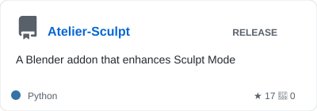
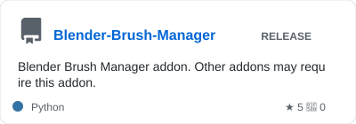
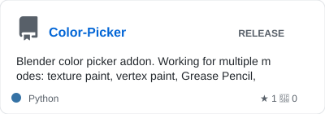
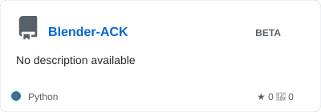
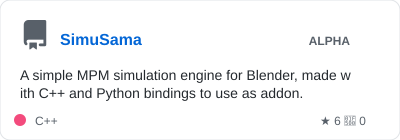
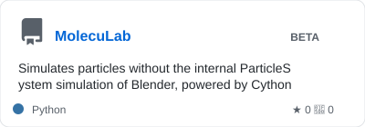
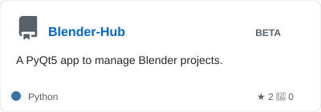
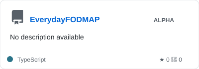

# Hello there!

# Featured Repositories

### Blender Add-ons

Tools and utilities for Blender

---

### Simulation & Physics

Simulation and physics utilities applied to Blender

---

### Standalone Applications

Independent software applications

---

